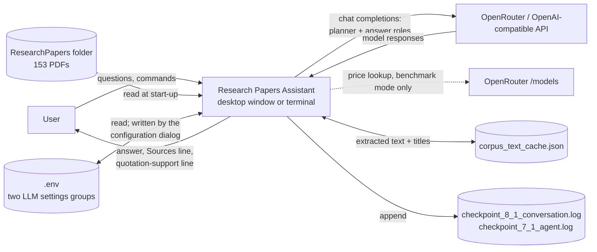
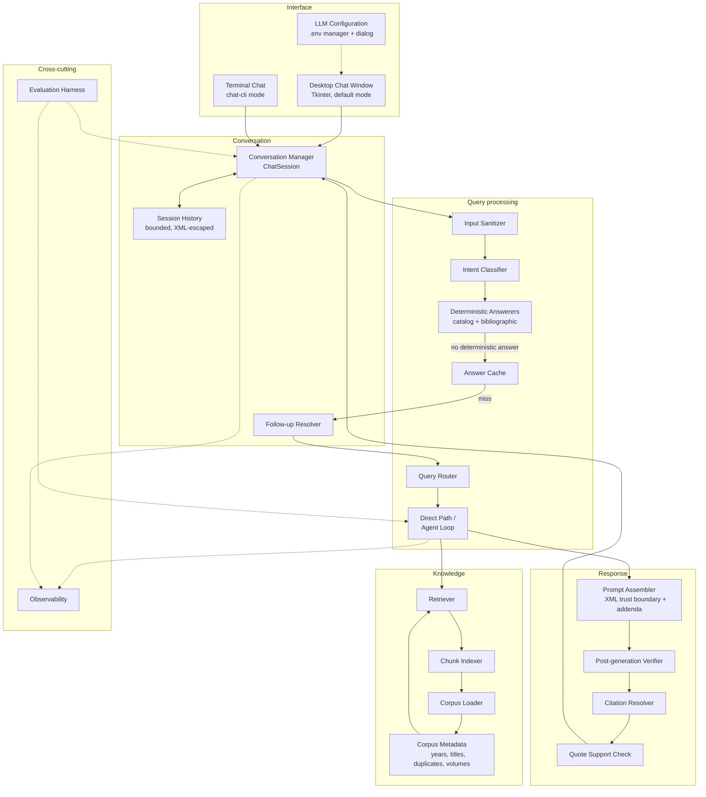
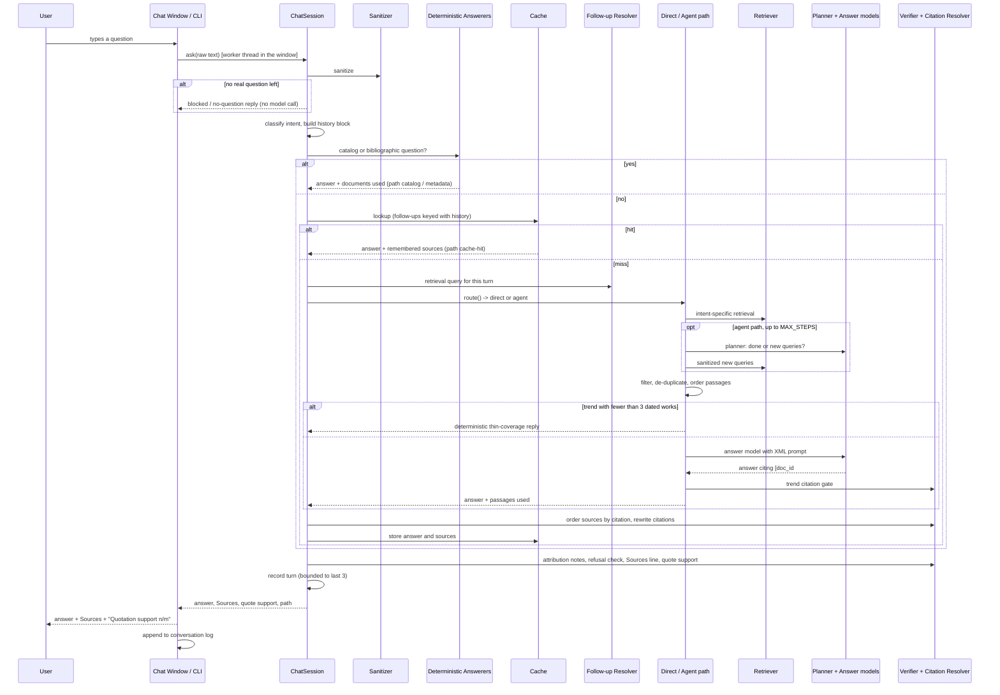
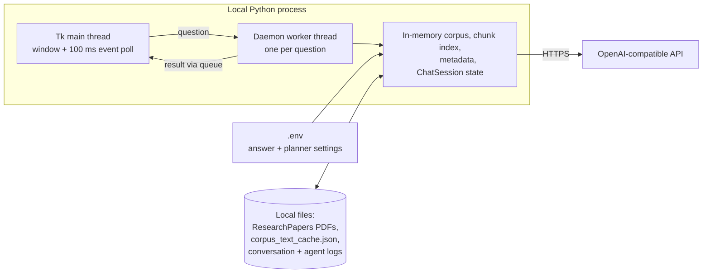

# Research Papers Assistant — Architecture Document

**Author:** Ranjan Chiplonkar
**Course:** MIT xPro, RAG and Context Engineering — Capstone, Module 8.1
**Implementation described:** `Ranjan_Research_Assistant_Final_Capstone_Submission.py` (final
capstone submission, ~4,060 lines, single file in Jupytext `# %%` cell format)
**Upstream document:** `research_assistant_spec.md` (requirements)
**Downstream documents:** `research_assistant_spec_design.md` (low-level design, as built),
`research_assistant_test_strategy.md`, `research_assistant_test_case_v4_run4_graded_v1.xlsx`
**Status:** As-built architecture, revised October 11, 2026 to match the final submission code.
The first version of this document (October 4) was a forward-looking baseline written against the
Checkpoint 7.1 code. This revision describes what the final code actually does, including the
components added during implementation and test review that the baseline did not anticipate
(section 12 lists them). A second update the same day records the post-review fixes D-1, D-2,
D-6 and D-8 (date-constrained questions, "change" wording, the bibliographic route, model-role
defaults, and the probe wrapper); see section 11 and section 19 of the design document.

## 1. Introduction and goals

### 1.1 Purpose of this document

This describes the architecture of the Research Papers Assistant: the components it is built from,
how they fit together, the data that moves through it, and the decisions behind that structure. It
exists so that a reviewer, a peer, or future-me can understand why the system is shaped the way it
is without reading four thousand lines of Python first. Function signatures, schemas, constants and
algorithms belong in the low-level design document; this document stays at the level of components
and their responsibilities.

### 1.2 Goals this architecture serves

From sections 2 and 3 of the requirements spec:

- Answer questions about a fixed research-paper corpus (153 PDFs on program synthesis, sketching
  and CEGIS, and LLM-for-code benchmarks) grounded in the actual text, for three question types:
  single-paper lookup, cross-paper comparison, and change over time.
- Make every answer checkable: readable citations, verified quotations, and an explicit signal
  when an answer is a refusal rather than an answer.
- Hold a real conversation: follow-ups such as "the second one" or "what year was that paper
  published?" resolve against earlier turns.
- Stay cheap and fast enough for back-and-forth use.
- Survive adversarial or careless input without being hijacked or becoming unusable through
  over-filtering.
- Carry forward the security and cost work verified in Checkpoint 7.1 rather than re-deriving it.

### 1.3 Non-goals

- No multi-tenant access control. This is a single-user desktop research tool.
- No ingestion of new documents at request time. The corpus is fixed at start-up; adding a paper
  means adding a PDF to the folder and restarting.
- No live web retrieval and no fallback to the model's own knowledge. If the corpus does not cover
  something, the system says so.
- No distributed deployment and no persistence of conversations across restarts.

## 2. Constraints

| Type | Constraint | Source |
|---|---|---|
| Technical | Python 3.11 / 3.12; LangChain (`langchain-core`, `langchain-openai`) talking to an OpenAI-compatible endpoint (OpenRouter by default) | Checkpoint 1.1 setup; `requirements_8_1_v1.txt` |
| Technical | Corpus is local PDF files, parsed with PyMuPDF with pypdf as fallback | `_read_pdf_text` |
| Technical | Two LLM roles, each configured independently in `.env` (endpoint, model, key): an **answer** model and a **planner** model. The answer model is the cheaper one and the planner the costlier one; this submission runs `openai/gpt-4o-mini` (answer) and `openai/gpt-5.4-nano` (planner), which are also the built-in defaults. If the planner group is omitted the planner falls back to the answer settings | `load_llm_settings`, `make_llm` |
| Technical | No vector database, no embedding model, no agent framework; retrieval is a hand-written BM25 index in plain Python | requirements file header; section 4 |
| Technical | Dependencies are pinned and installed automatically on first run if missing | `_ensure_dependencies` |
| Organizational | Submission is a GitHub repository plus a recorded presentation, graded complete/incomplete, due October 14, 2026 | 8.1 assignment details and rubric |
| Organizational | No credentials in the repository | 8.1 submission instructions |
| Organizational | Previously implemented safeguards and optimizations are preserved; the Checkpoint 7.1 benchmark must still be reproducible | spec section 7 |

## 3. Context and scope

### 3.1 System context

The assistant is one local Python process. It talks to one external service (an OpenAI-compatible
chat-completions endpoint, OpenRouter by default) and reads and writes a handful of local files.
There is no database server and no authentication service.

### 3.2 Scope of this iteration

In scope and implemented: a desktop chat window (default) and a terminal chat; a bounded
multi-turn session with follow-up resolution; publication-year resolution with content checks;
reader-facing titles and citations; duplicate-file collapse; intent-aware prompting for comparison
and trend questions; deterministic answers for collection-wide and bibliographic questions;
post-generation verification (trend citation gate, refusal detection, attribution and quote
checks); an in-app LLM configuration dialog; and offline plus live regression suites.

Out of scope: a web front end, session persistence, multi-user operation, and corpora other than
the one in hand.

## 4. Solution strategy

Five strategic decisions shape the system.

**1. Extend, don't rebuild.** The Checkpoint 7.1 sanitizer, XML trust boundary, guarded cache,
router, planner/answer split and BM25 retriever stay in place and still drive the benchmark path
(`run()`) exactly as before. The 8.1 work wraps them in a conversational session and adds new
components at narrow seams — mainly optional keyword arguments (`history_block`, `intent`,
`retrieval_query`, `k`, `per_doc`) on the existing answer functions, whose defaults reproduce the
7.1 behavior.

**2. One process, in memory.** Corpus, index, session state and UI all live in one Python process,
rebuilt at each start (the PDF text cache makes start-up cheap after the first run). This keeps the
whole system auditable end to end.

**3. Lexical retrieval, compensated for its known gaps.** Retrieval is BM25 over overlapping
~900-character chunks. Rather than adding an embedding index, the gaps BM25 showed during testing
are closed with targeted, inspectable rules: compound-identifier tokens (`sk_p`), small query
expansion and "sense" synonym tables (oracle → verifier/checker), bibliography down-weighting, a
per-paper cap, a cap on whole-proceedings volumes, and year-range filtering both for trend
questions and for questions restricted to a publication date ("papers published after 2010").

**4. Deterministic before generative.** Anything that can be answered exactly from metadata is
answered without an LLM: collection-wide questions ("how many papers are from before 2010?") from
the year index, and bibliographic questions ("what year and venue was the Solar-Lezama/Bodík
sketching paper?") from the paper's own record. Thin trend evidence (fewer than three dated works)
gets a fixed "the collection has little on this" reply instead of an invented timeline.

**5. Verify after generation, don't just instruct before it.** Prompts ask for grounded, cited
answers, but the program also checks the result: trend answers whose bullets do not cite a
retrieved passage are replaced by a refusal; quotes are verified against the corpus and traced to
their real source paper; a named "year + venue" paper that was not retrieved is flagged; and a
refusal lists its sources as "retrieved, not used" so retrieved papers are never presented as
support for an answer that was not given.

## 5. Building block view

### 5.1 Level 1 — major subsystems

### 5.2 Component responsibilities

**Corpus Loader** (`load_real_corpus`, `_read_pdf_text`). Walks the corpus folder, extracts each
PDF's text (PyMuPDF, then pypdf), compacts whitespace, rejoins words split at line-break hyphens,
and caches text and title in `corpus_text_cache.json` keyed by file name, size and modification
time. Files that extract to under 150 characters are reported as unreadable and skipped. Produces
one record per paper with both a 20,000-character preview and the full text. It is the only
component that reads the PDF folder.

**Corpus Metadata** (`_extract_year_details`, `_content_year`, `_extract_pdf_title`, duplicate
collapse inside `load_real_corpus`, `VOLUME_IDS`, `paper_title`). Gives every document the
metadata the rest of the system reasons with:

- *Publication year*: a filename cascade (arXiv id, 4-digit year, 2-digit year) checked against
  the year the document claims for itself (arXiv stamp, "to appear in YEAR"); when the content is
  two or more years later than the filename, the content wins and the mismatch is recorded. A
  short manual override table handles the cases the rules cannot (a NATO series number, three
  deliberately mislabeled files). Unknown is a legitimate result.
- *Display title*: largest-font text on page one, then PDF metadata, then the filename, with an
  override table for the mislabeled files; proceedings volumes are labelled "CAV 2011 proceedings
  volume" rather than by their editors.
- *Duplicates*: files with identical body text (a conference paper and its CoRR copy) are grouped;
  one canonical copy is indexed and cited, the others remain resolvable aliases.
- *Volumes*: whole-conference PDFs are identified so the retriever can cap them.

**Chunk Indexer** (`build_chunk_index`). Splits each canonical paper's full text into ~900-character
windows on a ~750-character step and builds an in-memory inverted index (term → chunk, term
frequency). The camel-case-split document id is indexed with every chunk, so author and venue names
in the file name are searchable. Built lazily once per process.

**Retriever** (`retrieve_chunks`). Scores chunks with BM25 after dropping question-describing words
and adding expansions, down-weights bibliography-like chunks, up-weights title/abstract chunks,
caps proceedings volumes (one passage per question, never front matter, unless the question names
the volume), filters by year range when asked, enforces a per-paper cap, and reserves one slot for
a passage that actually describes the mechanism the question names. When a non-trend question is
restricted to a publication date ("which papers on sketching were published in 2016?", "…published
after 2010…"), that date becomes a retrieval filter and the passages are further limited to those
that mention the question's most specific topic term, so the model never sees papers from other
years or off-topic papers from the right year. The per-paper cap is what lets
a comparison see more than one paper. A plain keyword retriever (`retrieve`) is kept only for the
"before" benchmark baseline.

**Input Sanitizer** (`_sanitize_user_text`, `_has_real_question`, `blocked_reply`). The first thing
every user turn passes through: Unicode normalization, removal of zero-width characters, a
2,000-character cap, removal of whole pasted "BEGIN … END EMAIL/SOURCE BLOCK" sections and forged
header lines, and neutralization of sentence-leading override and persona phrases. Legitimate
phrasings such as "verifiers act as oracles" survive. If no real question remains, the turn ends
without a model call, and the reply only mentions removed content if something was actually
removed. Planner-generated follow-up queries go through the same sanitizer.

**Intent Classifier** (`classify_intent`, `_comparison_queries`, `_trend_query_specs`,
`_question_year_range`). Labels each question `single`, `compare` or `trend` (with "compare X with
itself" treated as `single`; "change", "changed", "evolve", "over time" and similar wording count as
trend), and reads any date restriction ("2005-2008", "from 2005 to 2020", "between 2005 and 2010",
"before/after/since/in YEAR"). Intent
controls the answer shape and retrieval strategy — two independently retrieved sides for a
comparison, one year-filtered retrieval per date range for a trend — but never overrides the
router's direct/agent decision.

**Deterministic Answerers** (`catalog_answer`, `bibliographic_answer`). Answer two classes of
question without retrieval or an LLM: questions about the collection as a whole (counts and lists
by year or date range, from the year index) and questions asking a named paper's year or venue
(from its own record). The bibliographic route answers only about one named paper: it steps aside
for list questions ("which papers …") and when the question names a different year from the
matched paper's. Each returns the answer and the documents it used, so the Sources line still
works.

**Answer Cache** (`SimpleCache`). Normalized exact match plus fuzzy token-overlap match (Jaccard ≥
0.8), refusing a fuzzy hit when the two questions differ in a number or a direction word. Each
conversation has its own cache. A follow-up question is cached under a key that includes the
history block, so "what year was that published?" asked about two different papers does not share
an answer. The session remembers which sources went with each cached answer.

**Follow-up Resolver** (`_contextual_retrieval_query`, `_resolve_ordinal`, `answer_items`). Decides
what a follow-up question should retrieve. Ordinals ("the second one") are replaced by the item the
previous answer listed in that position; pronoun references ("that paper") are expanded with the
previous question, answer summary and source titles; a question that names its own topic is
retrieved as asked. This affects only the retrieval query — the model still receives the user's
question as typed, plus the history block.

**Query Router** (`route`). A regex/structure heuristic: more than one question mark, " and ", ";",
or comparison/trend/"which papers" wording sends a question to the agent path; everything else
goes to the single-call direct path.

**Direct Path / Agent Loop** (`answer_direct`, `agentic_answer`, and their `*_conversational`
wrappers). The direct path retrieves once and calls the answer model once. The agent path runs up to
`MAX_STEPS = 3` rounds in which the planner model reads what has been collected and either stops or
proposes up to two new queries (sanitized, capped at 300 characters). Comparison and trend
questions get their specialised retrieval first on either path. Before the answer call, trend
passages are filtered for topical relevance, de-duplicated by work, and sorted oldest first; if
fewer than three dated works remain, a deterministic thin-coverage reply is returned with no model
call. Conversational turns retrieve more context than the benchmark path (6 passages; up to 4 per
paper for single questions, 3 for comparison/trend).

**Prompt Assembler** (`build_system_prompt`, `_answer_messages`, `_turn_rules`, `_format_docs_xml`,
`_xml_prompt`). Composes the system prompt from the hardened base prompt plus addenda selected per
turn (grounding and citation rules; quote request; self-comparison; comparison or trend structure;
history note) and per-retrieval rules (instruction-like passage warning, duplicate-alias notes,
not-retrieved paper warning, mechanism hint). The user message carries `<documents>` (each passage
an escaped `<passage id title year same_work>` element), the escaped `<user_question>`, and, on
follow-ups, an escaped `<conversation_history>` block.

**Post-generation Verifier** (`_trend_answer_or_reject`, `_is_refusal`, `unverified_attribution_note`,
`quote_attribution_note`). Checks the model's output before it is shown: every bullet of a trend
answer must cite a passage that was actually retrieved, or the whole answer is replaced by a
"could not verify the timeline" reply; refusals are detected so their sources are labelled
"retrieved, not used"; a named year+venue paper that was not retrieved gets a caution note; and a
verified quote that comes from a different paper than the one it is attributed to gets a note.

**Citation Resolver** (`rewrite_inline_citations`, `display_label`, `sources_block`,
`_order_sources_by_citations`). The model cites passages by internal id (`[doc_id#n]`); after the
model call these are rewritten into "(Title (Year))", as are any stray `[paper: …]` markers or bare
document ids. The Sources line is built deterministically from the documents actually retrieved —
cited papers first, duplicates collapsed by canonical id and by normalized title, sorted by year for
trend answers. It never influences retrieval or the prompt.

**Quote Support Check** (`_quote_support`, `_quoted_spans`). Finds quoted spans of 20–400
characters that are not just paper titles and checks each against the normalized corpus text with
spaces removed (so PDF line-break splits do not cause false failures). The count is shown under
every answer.

**Conversation Manager** (`ChatSession`). The integration point. Owns the per-conversation cache and
bounded history and runs each turn through the pipeline in section 6.1. Returns a result
(answer, Sources line, quote support, path taken) and prints nothing, so both interfaces and the
test harness use it the same way. History keeps the last 3 turns, each with the question
(trimmed to 100 characters in the prompt), a 200-character answer summary, source ids, intent, and
the ordered list of up to 6 papers the answer presented.

**Desktop Chat Window** (`chat_window`). The default interface: a Tkinter window with transcript,
composer, Send/Exit buttons, `/sources`, `/help`, `/exit`, keyboard shortcuts, and a "Configure LLM
API Keys" dialog. Model calls run on a daemon worker thread and results come back through a queue
polled every 100 ms, so the window stays responsive. The session is created on the first question
and rebuilt when settings change.

**Terminal Chat** (`chat`). The same session in a read–answer loop with `/exit`, `/quit`,
`/sources` and `/help`; a failing turn prints a short message and the loop continues.

**LLM Configuration** (`read_env_values`, `validate_env_values`, `save_env_values`,
`load_llm_settings`, `make_llm`). Manages the two settings groups in `.env`. The planner group is
all-or-none; base URLs must be http(s). The dialog can save typed values or import another `.env`
file, preserving unrelated lines, and masks the key fields.

**Observability** (`ACTION_LOG`, `LAST_TRACE`, `log`, `log_conversation`, `_Tee`). `ACTION_LOG`
records every retrieval query and the passages it returned, in memory, for the life of the process;
`LAST_TRACE` holds the passages and documents behind the most recent answer. Each chat turn
(question, answer, Sources line, and in the window the quotation-support count) is appended to
`checkpoint_8_1_conversation.log`; the benchmark writes its summaries to `checkpoint_7_1_agent.log`
and can mirror all console output to a file named by `CHECKPOINT_RESPONSES_LOG`. All log text is
normalized to plain ASCII.

**Evaluation Harness** (`run`, `run_conversational_checks`, `run_conversation_probes`, `BENCH`,
`CONV_BENCH`, `PROBE`/`EXTRA_PROBES`/`STAGED_ATTACK`). Three in-file entry points: the Checkpoint 7.1
before/cold/warm benchmark and 7-probe × 3-condition security suite; an offline self-check suite
(intent, routing, year rules, prompt composition, sanitizer, citations, plus one check per defect
fixed in review) followed by a corpus year scan and two live multi-turn conversations; and the
injection probes replayed through `ChatSession.ask` including a staged two-turn attack. The external
harness (`Test_Research_Assistant.py` with `Test_Research_Assistant_v4_scenarios.py`) drives the
real chat window and scripted scenarios for the 145-case workbook.

## 6. Runtime view

### 6.1 Primary scenario — a question in an ongoing conversation

The `path` value returned with each answer is one of `blocked-empty`, `catalog`, `metadata`,
`cache-hit`, `direct` or `agent`; the test harness reads it to verify routing and caching.

### 6.2 Trend question

"How did Solar-Lezama's synthesis work evolve from the early sketching papers around 2005-2008 to
the LLM code papers of 2023-2025?" is classified `trend`. Each date range becomes its own
retrieval query (shared topic words, the words next to that range, query expansions, and the years
spelled out) with the retriever restricted to papers dated in that range and a larger candidate
pool. The merged passages are kept only if they mention the topic, collapsed to one passage per
work, and sorted oldest first. With three or more dated works the answer model is asked for one
cited bullet per year or period in ascending order; if any bullet lacks a valid citation, the
answer is replaced by a fixed refusal. With fewer than three dated works the reply says the
collection has little on the topic and names what it found, without a model call.

### 6.3 Follow-up question

After "What does the CRUXEval benchmark measure?", the follow-up "How does it compare to
LiveCodeBench?" matches the follow-up pattern. Because it contains a pronoun reference, the
retrieval query is expanded with the previous question, answer summary and source titles, while
the model sees the question as typed plus `<conversation_history>` (escaped, labelled as context
rather than source). An ordinal follow-up ("tell me about the second one") instead retrieves the
second paper the previous answer listed. A follow-up that names its own subject ("remind me what
CRUXEval measures") is retrieved as asked. If the user refers to a turn older than the last three,
the history note tells the model to say so and ask the user to restate it.

### 6.4 Adversarial input

A pasted block that forges a source or tries to override the system's behavior goes through the
same path. The sanitizer removes forged blocks and header lines entirely and replaces override or
persona phrases with a `[removed …]` placeholder, leaving the rest of the sentence in place; the
sanitized text then drives the cache key, intent, retrieval and prompt. If nothing answerable
remains the turn ends with no model call. Anything that remains reaches the model inside
`<user_question>`, escaped, under a system prompt that treats it as data. Retrieved passages are
escaped too, so a poisoned PDF page cannot close or forge a tag; if a retrieved passage contains
instruction-like text, an extra rule tells the model not to follow it and to add a note saying so.
Planner-generated queries are sanitized before they reach the retriever. A staged two-turn attack
(plant an instruction, trigger it later) fails because the planting turn is neutralized by the
sanitizer and history is labelled as non-instruction context.

## 7. Deployment view

Run with `python Ranjan_Research_Assistant_Final_Capstone_Submission.py [mode]`:

| Mode | What runs |
|---|---|
| *(none)* or `chat` | desktop chat window (default; `ASSISTANT_MODE=chat` does the same) |
| `chat-cli` | terminal chat |
| `benchmark` | Checkpoint 7.1 before/after benchmark and security probe suite |
| `conv-check` | offline self-checks, corpus year scan, two live multi-turn conversations; exit code 1 on any failure |
| `conv-probes` | injection probes and the staged attack through `ChatSession.ask` |
| `help`, `-h`, `--help` | usage message |
| anything else | usage message on stderr, exit code 2 |

There is no server and no network listener. On first launch without a valid `.env`, the window
opens the configuration dialog automatically. The corpus folder is a constant (`CORPUS_DIR`) with
several fallback relative paths. The first run parses every PDF and writes the text cache; later
runs only re-parse changed files.

## 8. Cross-cutting concepts

### 8.1 Security

There are three kinds of input with different trust levels: the system prompt (trusted
instructions), retrieved passages (trusted as *source material* but never as instructions), and
everything that comes from the user or is derived from them — the question, the conversation
history, and planner-generated queries (untrusted data). Defense is layered:

1. Edge normalization: NFKC, zero-width removal, length cap.
2. Phrase- and block-level neutralization in the sanitizer, tuned against a benign phrase list so
   legitimate questions are not altered.
3. Structural separation: escaped `<documents>`/`<passage>`, `<user_question>` and
   `<conversation_history>` elements, so neither the user nor a PDF can forge the boundary.
4. Explicit instructions in the hardened system prompt that user text, history and passage text are
   data; a turn-specific warning when a retrieved passage looks like an instruction.
5. Sanitized, capped planner queries and a hard step cap.
6. No secrets in output: key fields are masked in the dialog, keys live only in `.env`, and the
   scripted test scenarios check program output for key values.

Evidence: all 16 security and adversarial cases in the graded v4 run passed, and the Checkpoint 7.1
probe suite (7 probes × 3 conditions) still runs unchanged in `benchmark` mode.

### 8.2 Performance and cost

Cost is controlled at five points: deterministic answers for catalog, bibliographic and thin-trend
questions (no tokens at all); a per-session guarded cache (zero tokens on a hit); the router (one
answer call for simple questions instead of a planner loop); the planner/answer model split; and
chunked retrieval, which sends a few passages rather than whole papers. Conversational turns
deliberately retrieve more context (6 passages) than the benchmark path (4), trading some tokens
for more evidence per turn on follow-ups and comparisons; the history block adds a bounded few
hundred tokens.

### 8.3 Conversation state

Session state is deliberately thin: the last three turns, each reduced to a question, a
200-character answer summary, source ids, intent and an ordered item list of at most six papers.
Full retrieved text is never carried across turns. History goes into the user message as its own
escaped element after `<user_question>`, never into `<documents>`. State lives only in process
memory; closing the window ends the conversation.

### 8.4 Grounding and citation

The model cites passage ids; the program turns them into readable labels and builds the Sources
line from what was actually retrieved. Grounding is checked separately: quote verification against
the corpus, quote-to-paper attribution, the trend citation gate, and refusal detection. All of these
run after generation and only read data that already exists, so none of them can steer retrieval or
become an injection surface.

### 8.5 Data quality

The corpus is treated as imperfect by design. Year resolution prefers what a document says about
itself over what its file name claims and records every disagreement; duplicates are collapsed;
proceedings volumes are capped; and three files whose contents do not match their names are kept
on purpose as negative test cases, with display-title overrides and no year so they cannot be
mistaken for Solar-Lezama papers in a timeline.

### 8.6 Observability

Each conversation turn is logged with its answer and Sources line, and in the desktop window its
quotation-support count. Retrieval actions are kept in the in-memory action log, and the benchmark
prints and logs the last of them along with token, call, latency and cost totals. The corpus scan
for instruction-like passages runs in `benchmark` mode and is reporting-only; at question time the
same pattern is applied to the passages actually retrieved and only adds a prompt warning — nothing
is ever deleted from the corpus. `conv-check` prints the year-resolution statistics, unknown-year
files, filename/content year mismatches and collapsed duplicates.

## 9. Architecture decisions

| Decision | Alternative considered | Why this one |
|---|---|---|
| BM25 over chunks, plus targeted expansions and caps | Embedding / vector retrieval | No extra infrastructure or embedding cost; corpus is fixed and small; every retrieval rule is inspectable and was added in response to a specific failing test (identifier tokens, oracle→verifier, volume crowding) |
| Regex router (direct vs agent) | Classifier or LLM router | Zero latency and cost; question shapes that need multi-step retrieval are regular. Known gap: wording outside the pattern goes direct (section 11) |
| Separate intent classifier that never changes routing | Fold intent into the router | Keeps the measured 7.1 routing intact while letting comparison and trend questions get their own retrieval and answer shape on either path |
| Deterministic catalog and bibliographic answers | Let the LLM answer from retrieved passages | Six retrieved passages cannot see 153 documents; counts and lists from the index are exact and free |
| Content year overrides a contradicted filename year | Trust the DBLP filename | Testing found at least ten files whose own arXiv stamp or "to appear" banner is two or more years later than the filename year; the file's own date is the better evidence |
| Collapse duplicate files to one canonical work | Index every file | Duplicates double-counted works in Sources and trend timelines and wasted context |
| Cap proceedings volumes at one passage (unless named) | Treat volumes like papers | A multi-million-character volume otherwise wins on size and crowds out single papers, yet one volume holds a key CEGIS passage, so it is capped rather than excluded |
| Citations by passage id, resolved by the program | Ask the model to write titles and years | Titles and years become a deterministic lookup; the model cannot invent a year, and the trend gate can check citations mechanically |
| Post-generation trend citation gate | Rely on prompt instructions alone | Prompt instructions alone cannot guarantee every timeline entry is backed by a retrieved paper; a hard gate turns an unbacked timeline into an honest refusal (trade-off in section 11) |
| Date restrictions become retrieval filters (year + most specific topic term) | Let the model apply the date from the question | A model shown both 2009 and 2017 passages listed the 2009 paper as "published after 2010" (TC-046); filtering before generation makes the wrong-year answer impossible rather than discouraged |
| Per-session cache, follow-ups keyed with history | One global cache keyed on the question | Prevents a context-dependent follow-up from receiving another conversation's answer |
| Desktop Tkinter window as the default, terminal as `chat-cli` | Web UI, or terminal only | Standard library only, no network listener, demos well in a recording; the terminal stays for scripting and testing |
| Two `.env` settings groups with an in-app dialog | Single hard-coded model pair | Reviewers can run with their own endpoint and keys without editing code; planner falls back to the answer settings |
| Single process, no persistence | Session store | No requirement to resume conversations; keeps the system simple to run and audit |

## 10. Quality attribute scenarios

Measured against the graded v4 test run (`research_assistant_test_case_v4_run4_graded_v1.xlsx`:
145 cases, 137 pass, 7 fail, 1 blocked, 94.5% of cases run).

| Attribute | Scenario | Response | Evidence |
|---|---|---|---|
| Groundedness | Factual question about one paper | Answer quotes the paper; quote verified against corpus and shown as "Quotation support n/m" | Grounding and citation: 15/15 pass; individual-paper retrieval: 20/20 pass |
| Security | Forged e-mail/source block, override phrase, zero-width obfuscation, XML tag forgery, poisoned passage, staged two-turn attack | Attack neutralized, real question still answered | Security and adversarial: 16/16 pass |
| Over-filtering | Legitimate question containing trigger words ("verifiers act as oracles", "from now on in the loop") | Question passes through unchanged | Offline self-check "benign sanitizer phrasing is preserved" |
| Performance | Same question asked twice | Second answer from cache, zero tokens | Performance and cost: 11/12 pass (failure is an answer-content issue, not caching; section 11) |
| Cross-paper correctness | Compare two named benchmarks | Each side retrieved independently; answer addresses both | Cross-paper comparison: 11/12 pass |
| Trend honesty | Change-over-time question | Chronological, cited bullets, or an explicit thin-coverage or could-not-verify reply | Trend: 13/17 pass — the weakest area (section 11) |
| Conversational usability | "The second one", "what year was that paper published?" | Resolved against the previous answer's list and sources | Conversational usability: 13/14 pass |
| Data quality | Mislabeled, duplicate and volume files | Correct display titles and years; duplicates listed once | Data quality and corpus integrity: 13/13 pass |
| Operability | Missing key, bad URL, missing corpus, model error | Clear message, no crash, setup dialog | Operational and configuration: 9 pass, 1 blocked (harness path issue) |

The October 11 fixes target TC-133 and TC-145 directly and TC-046 indirectly. Offline traces through
the real pipeline (stand-in models, real corpus) show each now receives the right evidence, and all
87 offline self-checks pass, but the graded figures above are from the run before the fixes. They
change only when those cases are rerun against the live models.

## 11. Risks and technical debt

Known limitations, most of them confirmed by failing cases in the graded run:

- **Trend coverage is the weakest area (4 of 17 failed).** The citation gate is strict: if any one
  bullet lacks a valid citation, the whole answer becomes "could not verify the timeline" even when
  good evidence was retrieved (TC-020, TC-021). Accepting the partially cited answer, or retrying
  once, would recover these at some risk of letting an uncited claim through.
- **Intent and routing are fixed patterns.** "change"/"changes" and "from YYYY to YYYY" ranges were
  added after TC-145 failed, but other change-over-time wording ("how has the field developed since
  2010?", "the progression from sketching to neural methods") is still classified `single`, as the
  harness's `intent_table` scenario shows. Comparison or trend questions phrased without the listed
  words are answered more narrowly than they deserve.
- **Date filters are regex-based.** A date restriction is applied only when the question also uses
  publication wording (papers, published, appeared, …) and states exactly one range; anything more
  complex is answered without the filter.
- **Not-retrieved papers can still be described from model knowledge.** The not-retrieved rule is a
  prompt instruction plus a post-answer note, not a hard gate; one comparison described an
  unretrieved "2008 PLDI paper" in hedged terms (TC-017).
- **Follow-up comparisons can retrieve only one side.** A pronoun follow-up such as "how does it
  differ from sketching?" late in a long conversation ended in a refusal (TC-067); the follow-up
  resolver expands with the previous turn but does not split the two sides.
- **Long trend spans retrieve more context.** A wide range ("2005 to 2020") now retrieves up to 20
  candidate passages and can hand the model a dozen or more works; that costs more tokens and, with
  the strict citation gate above, raises the chance that one uncited bullet sinks the answer.
- **Lexical retrieval has a ceiling.** Heavy paraphrases of the corpus vocabulary will miss; the
  expansion tables cover only the gaps found in testing.
- **Year metadata is heuristic.** Filename rules plus content checks plus overrides fit this corpus;
  a different collection would need its own rules or a real metadata source.
- **Conversation log stores the raw user turn.** `log_conversation` writes the text as typed
  (ASCII-normalized), not the sanitized version. Acceptable for a local single-user tool; worth
  revisiting if logs are ever shared.
- **Shared module-level trace state.** `LAST_TRACE` and `ACTION_LOG` are process globals. The window
  allows one question at a time, so this is safe today, but concurrent sessions would need per-call
  state.
- **No persistence and one user.** Closing the window loses the conversation; the design does not
  extend to multiple concurrent users without rework.

## 12. Changes from the first architecture baseline

| Area | Baseline (October 4) | As built |
|---|---|---|
| Interface | CLI loop; web UI optional | Tkinter desktop window by default, terminal as `chat-cli`, in-app LLM configuration dialog |
| Model configuration | Two fixed models | Two configurable roles in `.env`, with planner fallback and validation |
| Question handling | Sanitize → cache → route → answer | Sanitize → intent → deterministic answerers → cache → follow-up resolution → route → answer → verify |
| Metadata | Filename year regex | Filename cascade + content-year check + overrides; extracted titles; duplicate collapse; volume detection |
| Retrieval | BM25 with per-paper cap | Adds identifier tokens, query expansions, mechanism-passage slot, volume cap, year-range filter, per-side comparison and per-range trend retrieval, larger conversational context |
| Prompting | Comparison addendum | Grounding/citation, quote, self-comparison, comparison, trend and history addenda plus per-retrieval rules |
| Verification | Quote check surfaced to user | Adds trend citation gate, thin-trend fallback, refusal detection, quote-attribution and unverified-attribution notes |
| Session memory | Question + summary | Adds ordered item list for ordinals, per-session cache keyed with history for follow-ups |
| Observability | "Action log written to a log file"; corpus scan at load time | Action log is in memory; conversation log per turn; corpus scan in benchmark mode; per-turn passage check |
| Evaluation | Benchmark + conversational checks | Adds review-defect self-checks, conversational probe replay with staged attack, external 145-case harness |
| Post-review fixes (Oct 11) | — | "change" wording and "from/between YYYY to/and YYYY" ranges are trend questions; long spans no longer padded with year tokens; date-restricted questions filter retrieval by year and topic; bibliographic route limited to one named paper; defaults match the configured cheaper-answer / costlier-planner roles; probe wrapper signature fixed. Offline self-checks: 87 (was 76) |

## 13. Relationship to the other documents

- `research_assistant_spec.md` — what the system must do and why (unchanged by this revision).
- `research_assistant_spec_design.md` — function-level design of every component above, with
  constants, data structures, algorithms, error handling and traceability, matched to the final code.
- `research_assistant_test_strategy.md` and the v4 workbook — how each quality attribute in
  section 10 is tested, and the graded results cited there.
